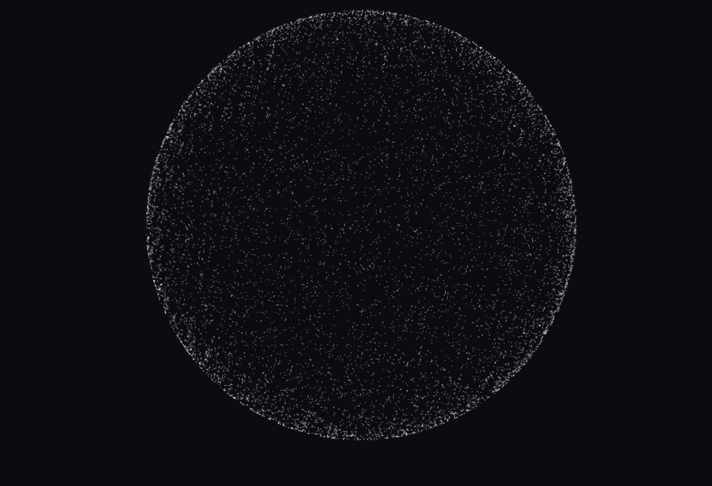

<div align="center">

<h1>3D Particle Sphere</h1>

<p><b>A drop-in 3D particle sphere for any page.</b></p>

<p><i>A Spline scene on a transparent page, so it floats over whatever your site already has behind it.</i></p>

<h6>


</h6>

<a href="https://parthchandak02.github.io/3d-particle-sphere/"><b>Live demo</b></a> ·
<a href="#embed-it"><b>Embed it</b></a> ·
<a href="#how-it-works"><b>How it works</b></a> ·
<a href="#run-it"><b>Run it</b></a>

<br><br>

<a href="https://parthchandak02.github.io/3d-particle-sphere/"></a>

<sub>Live capture from GitHub Pages, cropped to the sphere. The page itself is transparent; a dark background was added behind it for the screenshot.</sub>

</div>

<br>

A sphere of white particles, built in [Spline](https://spline.design) and rendered in the browser
by `@splinetool/react-spline`. The page around it has no background of its own, so it can sit
behind a hero section or inside an iframe and pick up the colour of the host page. White
particles need a dark host to be visible.

## Embed it

The quickest route is an iframe of the live page. Iframes are transparent unless the framed page
paints a background, and this one doesn't:

```html
<div style="background:#0b0b10; height:600px">
  <iframe src="https://parthchandak02.github.io/3d-particle-sphere/"
          style="width:100%; height:100%; border:0" title="3D particle sphere"></iframe>
</div>
```

In a React app, skip the iframe and load the scene directly; this is the whole of `src/App.js`:

```jsx
import Spline from '@splinetool/react-spline';

export default function App() {
  return (
    <div style={{ width: '100vw', height: '100vh', backgroundColor: 'transparent' }}>
      <Spline scene="https://prod.spline.design/Klk6kydm2OqssauT/scene.splinecode" />
    </div>
  );
}
```

## How it works

| Piece | Role |
|---|---|
| Spline scene (`prod.spline.design/.../scene.splinecode`) | The particle sphere itself: geometry, material and camera. It lives on Spline's CDN, not in this repo |
| `@splinetool/react-spline` | Downloads the scene and renders it into a WebGL canvas |
| `src/index.css` | Sets `html`, `body` and `#root` to full size, no margin, transparent background |
| `gh-pages` | Publishes the Create React App build to the `gh-pages` branch |

Changing the sphere means editing the scene in Spline and re-exporting; the React code only
points at the scene URL. The sphere sits right of centre, where the Spline camera puts it.

## Run it

```bash
git clone https://github.com/parthchandak02/3d-particle-sphere.git
cd 3d-particle-sphere
npm install
npm start          # dev server on localhost:3000
npm run deploy     # build and push to GitHub Pages
```

<br>

<div align="center">
<sub>Built with Spline, React 18 and Create React App. Apache 2.0.</sub>
</div>
